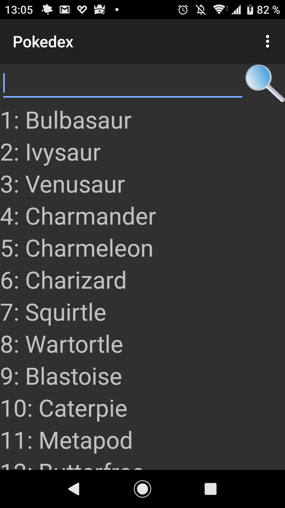
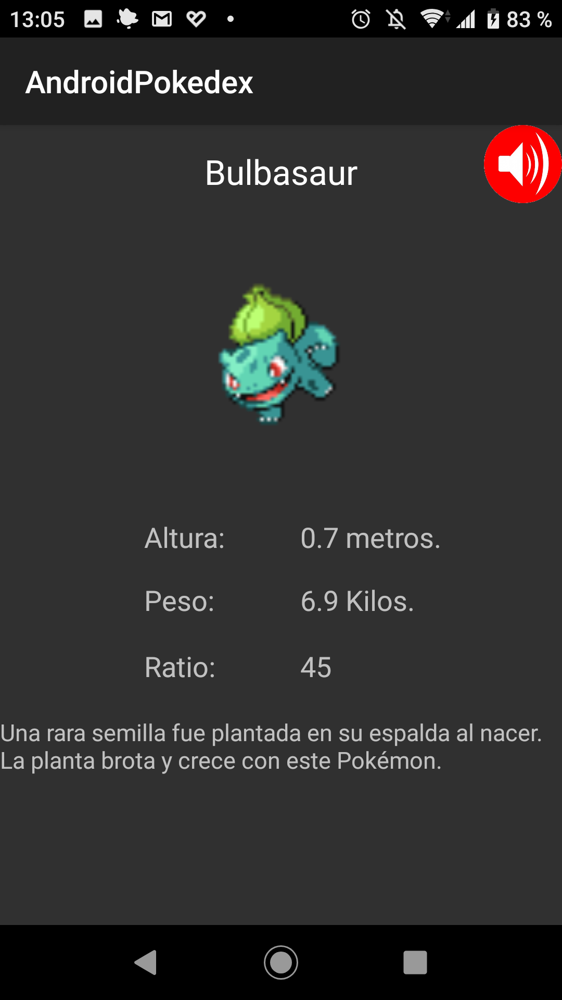
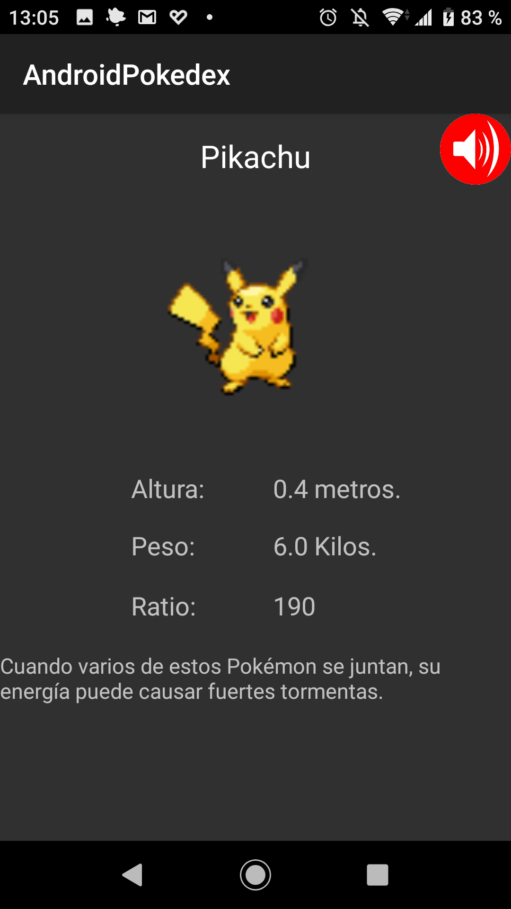
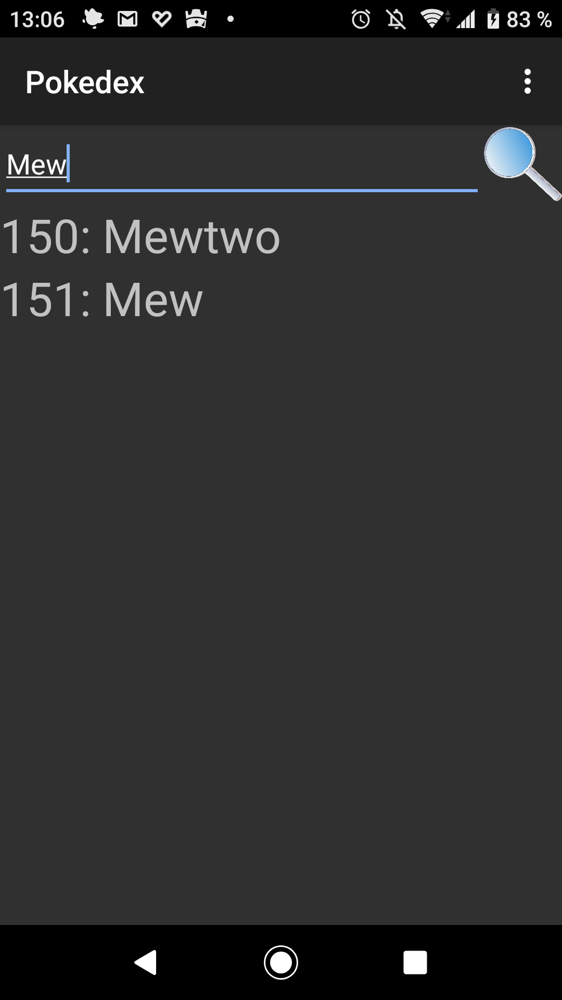
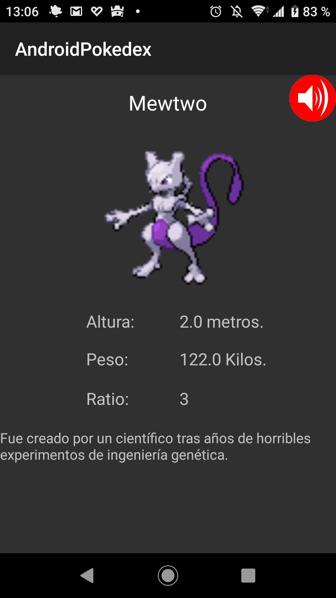

# AndroidPokedex
Pokédex sin conexión con los 151 Pokémon originales, sus imágenes y sonidos.
Incluye búsqueda por nombre, descripciones de los juegos Azul y Rojo, altura,
peso y ratio de captura.

## Versión modernizada

- Objetivo y SDK de compilación: **Android 17 / API 37**.
- Versión mínima: **Android 6.0 / API 23**. Ya no se soporta Android 2.x.
- Java 17, Android Gradle Plugin 9.3.0 y Gradle Wrapper 9.5.0.
- Interfaz AndroidX con tema claro/oscuro, lista reciclable y detalles desplazables.
- Edge-to-edge con márgenes para barras del sistema, recortes y teclado.
- Búsqueda en segundo plano, filtros literales seguros y restauración del estado.
- Audio asíncrono que se libera al salir de la pantalla; sin `AsyncTask`.
- Sin permisos de almacenamiento ni conexión a Internet.

## Abrir y compilar

1. Abrir **esta carpeta raíz como proyecto Gradle** en una versión de Android Studio
  compatible con AGP 9.3. No importar el módulo Java/ADT antiguo.
2. Seleccionar **JDK 17** para Gradle y establecer `JAVA_HOME` si se compila por consola.
  Java 8 no sirve para esta versión.
3. En SDK Manager, instalar **Android SDK Platform 37.0**, **Build-Tools 36.0.0**
  y **Platform-Tools**, revisando las licencias oficiales.
4. Configurar `ANDROID_HOME` apuntando al SDK, o dejar que Android Studio genere
  la propiedad `sdk.dir` en el archivo local de propiedades de Gradle.
5. Sincronizar Gradle y ejecutar la configuración de aplicación.

Desde PowerShell, ejecutar `./gradlew.bat assembleDebug`. En Linux/macOS usar
`sh ./gradlew assembleDebug`. El wrapper descarga y verifica Gradle automáticamente.

El APK de desarrollo se genera en [build/outputs/apk/debug/AndroidPokedex-debug.apk](build/outputs/apk/debug/AndroidPokedex-debug.apk).
`assembleRelease` produce un APK **sin firmar**: para publicar o actualizar una
instalación antigua se necesita la clave de firma original. No se incluyen claves
ni contraseñas en el repositorio. Se conserva `vic.software.androidpokedex` y se
incrementa `versionCode` a 2.

### Estructura y base de datos

Se mantienen [src](src), [res](res) y [assets](assets) mediante los source sets
de [build.gradle](build.gradle). Los artefactos antiguos en las carpetas de
generados y compilados, el proyecto Ant y el JAR support-v4 **no participan**
en la compilación moderna. Los archivos locales del IDE no se modifican.

[assets/DBPOK](assets/DBPOK) se conserva intacta, con 151 entradas y
`user_version=0`. En el primer uso se copia a un temporal del directorio privado
de bases de datos; se valida antes de publicarla con un renombrado atómico.
El catálogo se abre solo para lectura y todos los cursores se cierran.
Se usa un nombre de catálogo versionado distinto del original: la base instalada
por la versión antigua no se borra ni se sobrescribe. No hay datos personales que
migrar. Una futura actualización del catálogo deberá aumentar su versión de
archivo y ajustar su validación, sin mezclarlo con futuros favoritos u otros datos
del usuario. Si se detecta corrupción se muestra un error, no se borran datos
silenciosamente. El catálogo se puede recrear borrando los datos de la app.

Los 151 sprites y sonidos tienen referencias explícitas en
[PokemonResources.java](src/vic/software/androidpokedex/PokemonResources.java).
La primera versión modernizada deja desactivada la ofuscación/reducción de recursos
para facilitar el diagnóstico. Los recursos gráficos conservan su resolución original.

### Pruebas

- `./gradlew.bat testDebugUnitTest`: filtros, comillas, comodines y espacios.
- `./gradlew.bat lintDebug`: análisis estático Android.
- `python tests/validate_assets.py`: integridad SQLite, las 151 fichas, búsquedas,
  imágenes, sonidos y XML; requiere Python 3, no requiere SDK.
- `./gradlew.bat assembleDebugAndroidTest`: compila las pruebas instrumentadas.
- `./gradlew.bat connectedDebugAndroidTest`: ejecuta importación, reapertura,
  consultas y correspondencia de los 151 recursos en un dispositivo/emulador.
  **Solo usar un dispositivo de pruebas**: se recrea el catálogo de la app.

La CI compila debug/release, ejecuta lint y pruebas unitarias, valida los assets y
compila las pruebas instrumentadas. Estas últimas requieren un dispositivo para
ejecutarse; compilarlas no equivale a probar la aplicación en Android.

Comprobaciones manuales recomendadas en API 23, 35, 36 y 37: instalación limpia,
actualización con la misma firma, búsqueda con comillas y comodines, búsqueda sin
resultados, rotación con filtro y scroll, fuente al 200 %, horizontal, multiventana,
modo oscuro, navegación gestual y de tres botones, sonido repetido y salida durante
la reproducción. Para publicar en Google Play, generar y firmar también el AAB
con `bundleRelease` y revisar sus requisitos vigentes.

## Change Log
### [2.0.0] - 2026-10-28
- Migración de ADT/Ant a Gradle, AndroidX, Java 17 y objetivo Android 17.
- Correcciones de datos, audio, ciclo de vida, accesibilidad y diseño adaptable.
- Pruebas automatizadas y compilación real en CI.

### [1.0.0] - 2013-03-15
#### Added
- Primera versión en desarrollo.

## Información facilitada

- Descripción.
- Altura.
- Peso.
- Ratio de captura.

## Imágenes históricas (versión 1.0):
<table border="0" cellpadding="0" cellspacing="0" width="100">
<tr>
<td></td>
  <td></td>
  <td></td>
  <td></td>
  <td></td>
</tr>
</table>

